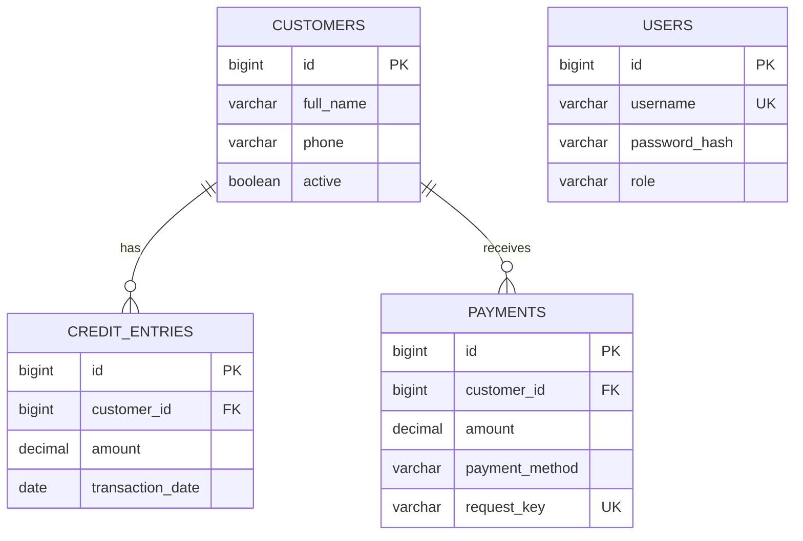

 Par# Smart Shop Credit Tracker

A Java + Spring Boot + JDBC + MySQL web application for shop staff to manage customer credit, repayments, ledgers and reports. Frontend is plain HTML, CSS, JavaScript, Bootstrap 5 and Fetch API. Financial records in MySQL are the source of truth; balances are calculated from credit and payment rows.

> Academic project / local-development quality. Do not use for real financial operations without a security, privacy, backup, audit and operational review.

## Architecture

```text
Browser (HTML / CSS / JS / Fetch API)
          │ HTTP + session cookie
          ▼
Spring Security → REST Controller → Service / validation
                                     │ @Transactional
                                     ▼
                              Repository / JdbcTemplate
                                     │ parameterized SQL
                                     ▼
                                   MySQL
```

The browser never connects to MySQL. Controllers handle HTTP, services enforce business rules, repositories issue SQL, and the database stores the financial records. Amounts use `DECIMAL(12,2)` in MySQL and `BigDecimal` in Java.

## Folder layout

```text
backend/                 Spring Boot application, API, security and tests
  src/main/java/         controller, service, repository, model, dto, config
  src/main/resources/    application.properties
  src/test/java/         service unit tests
database/schema.sql      MySQL database and tables
database/sample-data.sql Optional development-only Ravi example
frontend/                Login and dashboard UI (HTML, CSS, JavaScript)
docs/                    Academic report and detailed endpoint reference
.env.example             Safe names/template for local environment variables
```

## Requirements and verification

- JDK 17 or newer (the project targets Java 17 bytecode); Maven 3.6.3+.
- MySQL Server 8.0+.
- VS Code with Extension Pack for Java, Spring Boot Extension Pack, and Live Server (or any static web server).
- A current browser. Bootstrap 5.3 is loaded from jsDelivr, so the browser needs internet access for those CDN assets.

In PowerShell:

```powershell
java -version
mysql --version
```

Install a supported JDK and MySQL Server if any command is unavailable. Maven installation is optional because the project includes the Maven wrapper (`backend/mvnw.cmd`). Java 25 is installed in the initial development environment; it is newer than the project's Java 17 target.
The included Maven wrapper requires `JAVA_HOME`; point it at the JDK installation folder (not its `bin` subfolder). On the development PC used to verify this project:

```powershell
$env:JAVA_HOME = "C:\Program Files\Java\jdk-25"
```

## Database setup (first run)

1. Start the MySQL service and sign in with an administrator account:

   ```powershell
   mysql -u root -p
   ```

2. Run the schema from PowerShell (replace the path only if you placed the project elsewhere):

   ```powershell
   mysql -u root -p < "D:\Smart Shop Credit Tracker\database\schema.sql"
   ```

   Or execute the contents of `database/schema.sql` in MySQL Workbench. `customers` stores people, `credit_entries` stores purchases, and `payments` stores repayments. Foreign keys prevent transactions from referring to missing customers. A user's password is stored only as a BCrypt hash.

3. Create a restricted local app account in the MySQL prompt, using a new password in place of the example:

   ```sql
   CREATE USER 'smart_shop_app'@'localhost' IDENTIFIED BY 'choose-a-strong-local-password';
   GRANT SELECT, INSERT, UPDATE, DELETE ON smart_shop_db.* TO 'smart_shop_app'@'localhost';
   ```

4. In the PowerShell window that will run the backend, configure credentials. Use your own values; do not commit them:

   ```powershell
   $env:SHOP_DB_URL = "jdbc:mysql://localhost:3306/smart_shop_db?useSSL=false&allowPublicKeyRetrieval=true&serverTimezone=UTC"
   $env:SHOP_DB_USERNAME = "smart_shop_app"
   $env:SHOP_DB_PASSWORD = "your-local-database-password"
   $env:SHOP_BOOTSTRAP_USERNAME = "admin"
   $env:SHOP_BOOTSTRAP_PASSWORD = "a-unique-password-of-at-least-12-characters"
   ```

   `SHOP_BOOTSTRAP_PASSWORD` is used only if the `users` table is empty. The password is immediately BCrypt-hashed. Store secrets outside source control; `.env.example` is a reference, not an automatically loaded file.

Optional development-only sample data:

```powershell
mysql -u root -p smart_shop_db < "D:\Smart Shop Credit Tracker\database\sample-data.sql"
```

It creates Ravi's ₹2,000 credit and ₹800 sample payment (₹1,200 remaining). Do not run it against business data.

## Run

Quick start (simple Thanglish):

1. MySQL Server start pannunga; schema script-ai oru murai run pannunga.
2. JDK install folder-ai `JAVA_HOME`-la set pannunga. Backend run panna pora PowerShell-la `SHOP_DB_PASSWORD` and `SHOP_BOOTSTRAP_PASSWORD` set pannunga.
3. `backend` folder-la `.\mvnw.cmd spring-boot:run` run pannunga. First time Maven dependencies download aagum; internet venum.
4. Innoru PowerShell-la `frontend` folder-ku poi `python -m http.server 5500` run pannunga.
5. Browser-la `http://localhost:5500/login.html` open panni, bootstrap username/password use panni sign in pannunga.

Open one PowerShell window at the project folder, set the database and bootstrap environment variables above, then run:

```powershell
Set-Location "D:\Smart Shop Credit Tracker\backend"
.\mvnw.cmd spring-boot:run
```

Open a second PowerShell window:

```powershell
Set-Location "D:\Smart Shop Credit Tracker\frontend"
python -m http.server 5500
```

If `python` is not on PATH, use `py -m http.server 5500`. Open <http://localhost:5500/login.html>. Sign in with `SHOP_BOOTSTRAP_USERNAME` and `SHOP_BOOTSTRAP_PASSWORD`. Stop either server with Ctrl+C. Environment variables must be set in the same PowerShell window that runs Maven.

To test via Maven:

```powershell
Set-Location "D:\Smart Shop Credit Tracker\backend"
.\mvnw.cmd test
.\mvnw.cmd package
```

## Authentication and transaction safety

- Login uses Spring Security's JDBC user lookup and BCrypt password hashes; authenticated browser requests use an HTTP session cookie.
- CSRF protection uses a cookie token, submitted in the `X-XSRF-TOKEN` header. CORS is restricted to the local frontend origins configured in `SecurityConfig`.
- Customer rows are locked (`SELECT … FOR UPDATE`) during credit/payment writes. Payment validation and insert are in a database transaction, so simultaneous payments for the same customer serialize. MySQL is assumed to use InnoDB.
- Payment requests require a unique request key. The UI keeps the same key for a retry after a network error; database uniqueness prevents recording the same key twice.
- This does not provide a complete audit trail, distributed idempotency protocol, backup plan, or production-grade account-management flow. Configure HTTPS and production cookies/CSRF/CORS before deployment.

## API reference

All `/api/**` endpoints except the CSRF bootstrap and login require an authenticated session. JSON dates use `YYYY-MM-DD`; monetary fields are decimal numbers. Errors use JSON with `timestamp`, `status`, `error`, `message`, and optional `fields`.

| Method | URL | Purpose / request |
|---|---|---|
| GET | `/api/auth/csrf` | Get CSRF token before login; returns `{ "token": "…" }`. |
| POST | `/api/auth/login` | Sign in: `{ "username": "admin", "password": "…" }`; session cookie is set. |
| GET | `/api/auth/session` | Current signed-in staff identity. |
| POST | `/api/auth/logout` | End session; include CSRF header. |
| GET | `/api/customers?search=nameOrPhone` | Customer list/search with calculated credit, payment and balance totals. |
| GET | `/api/customers/{id}` | Customer detail. |
| POST | `/api/customers` | Create `{ "fullName": "Ravi Kumar", "phone": "9876543210", "address": "Chennai" }`. |
| PUT | `/api/customers/{id}` | Replace editable customer details using the same request shape. |
| PATCH | `/api/customers/{id}/status` | Archive/restore: `{ "active": false }`; financial rows remain. |
| GET | `/api/customers/{id}/credits` | Customer's credit history. |
| GET | `/api/credits` | Latest 100 credits across customers. |
| POST | `/api/credits` | Create `{ "customerId": 1, "description": "Groceries", "amount": 2000, "transactionDate": "2026-10-21", "notes": "" }`. |
| GET | `/api/customers/{id}/payments` | Customer's repayments. |
| GET | `/api/payments` | Latest 100 payments across customers. |
| POST | `/api/payments` | Create `{ "customerId": 1, "amount": 800, "transactionDate": "2026-10-21", "paymentMethod": "CASH", "requestKey": "unique-retry-key" }`. |
| GET | `/api/customers/{id}/ledger` | Customer, totals, and date-ordered running ledger. |
| GET | `/api/dashboard` | Live summary and latest transactions. |
| GET | `/api/reports/outstanding` | Outstanding balance per customer, including archived accounts with dues. |
| GET | `/api/reports/dues` | Pending dues and oldest credit estimate. |
| GET | `/api/reports/credits?from=2026-10-01&to=2026-10-31` | Credit transactions in date range. |
| GET | `/api/reports/payments?from=2026-10-01&to=2026-10-31` | Payment collections in date range. |

Validation returns 400 for invalid fields, 401 for unauthenticated requests, 404 for missing customers, and 409 for business-rule/duplicate conflicts. Credit/payment must be positive; payment cannot exceed the balance; future transaction dates and future report ranges are rejected. The backend does not trust a frontend-provided balance.

## Tests and expected workflow

Automated unit tests cover overpayment rejection, the Ravi ₹2,000 credit → ₹800 payment → ₹1,200 remaining example, full settlement, duplicate request-key handling, and amount precision/positive-value validation. Run `.\mvnw.cmd test`; do not treat unrun checks as passing.

| Check | Expected result |
|---|---|
| Register a valid customer | Saved customer is returned and listed. |
| Blank name / invalid phone | HTTP 400 with field-level message. |
| Search name or phone | Matching database rows only. |
| Record ₹2,000 credit | Balance increases by ₹2,000. |
| Pay ₹800 against ₹2,000 | Saved; remaining balance ₹1,200. |
| Pay remaining ₹1,200 | Saved; remaining balance ₹0. |
| Negative/zero credit or payment | HTTP 400; no financial record inserted. |
| Pay more than balance | HTTP 409; no payment inserted. |
| Ledger/dashboard | Totals agree with transaction rows; ledger running balance is chronological. |
| Unknown customer ID | HTTP 404; no row inserted. |
| Database unavailable | Application reports connection failure in backend logs; no success response. |
| Archive customer | Hidden from active counts; financial history remains readable. |
| Retry payment with same request key | Existing payment is returned; no second row. |
| Two concurrent payments | Customer lock serializes checks; only payments within available balance succeed. |
| Signed-out request | HTTP 401; browser navigates to login. |

The Maven unit tests were executed successfully: 5 tests, 0 failures, 0 errors. MySQL/browser workflow checks require the database credentials and application to be configured and started as described above; those integration checks and screenshots have not been run/captured in this workspace.

## Academic report notes

### Problem → Solution → Implementation → Result

- **Problem:** Notebook-based credit and repayment records make it difficult to calculate dues and retrieve transaction history.
- **Solution:** A web application gives staff customer records, credit entries, payments, ledgers and database-backed summaries.
- **Implementation:** HTML/CSS/JavaScript frontend calls Spring Boot REST APIs; JDBC repositories use parameterized SQL with MySQL foreign keys and transactions.
- **Result:** After execution, demonstrate that Ravi's ₹2,000 credit less ₹800 paid shows ₹1,200 due, and that another ₹1,200 payment clears the balance. This is an expected demonstration, not a claimed executed result.

### System modules and database model

`users` stores staff login hashes/roles; `customers` stores customer profiles/status; `credit_entries` and `payments` store immutable financial entries. One customer has many credit entries and many payments. `credit_entries.customer_id` and `payments.customer_id` reference `customers.id`. The current balance is `SUM(credit_entries.amount) - SUM(payments.amount)`.

### Diagrams

Architecture: browser → REST controller → service → JdbcTemplate repository → MySQL.

ER relationship (Mermaid):



Use case: staff signs in → maintains customers → records credit/payment → reviews ledger, dues and reports. Data flow: labelled customer form → validated REST request → service rule checks → parameterized SQL write → calculated totals from stored rows → JSON response → updated UI.

### Results/screenshots to capture yourself

After running the application, capture: login page; populated dashboard; customer list and add form; customer details; credit form/history; payment form showing balance; Ravi ledger showing ₹2,000 / ₹800 / ₹1,200; pending-dues table; date-filtered report and CSV export; invalid overpayment error. Use your own running application screenshots; none are supplied here.

### Limitations and future enhancements

Payments are not allocated to specific credit entries, so oldest-credit age is only an estimate. There is no SMS/email/WhatsApp integration, multi-shop tenancy, staff user-management screen, automated backup, deployment pipeline, or detailed audit log. Possible next steps: per-purchase payment allocation, audited adjustments, password reset and staff administration, reminders using a real provider, role-based permissions, database backups, deployment and security review.

## Internship / viva preparation

- **Resume-ready:** Built a full-stack shop credit tracker using Java, Spring Boot REST, JdbcTemplate, MySQL and vanilla JavaScript; implemented customer management, positive-amount credit/payment rules, BCrypt-backed login, ledgers and database-driven reports.
- **Internship summary:** Replaced a paper-ledger workflow with a relational web application. Spring services validate financial operations, MySQL transactions and row locks protect balance checks, and the UI fetches computed customer balances and chronological histories.
- **Two-minute demo:** Sign in → add Ravi → record ₹2,000 credit → show dashboard/ledger → record ₹800 payment → show ₹1,200 balance → pay ₹1,200 → show zero balance → open dues and date-range reports.
- **How balance works:** It is computed as total credit rows minus total payment rows for that customer; frontend values are never used for financial validation.
- **How web/database communication works:** JavaScript Fetch sends HTTP JSON to controller endpoints; service logic validates; JdbcTemplate runs parameterized SQL; JSON results update the page.
- **Sample viva questions:** What does a foreign key do? (It enforces a valid relationship to a customer.) Why `BigDecimal`? (It avoids binary floating-point rounding for currency.) What does `@Transactional` do? (It commits related operations together or rolls them back on failure.) Why JDBC rather than JPA? (This project explicitly demonstrates SQL and JdbcTemplate.) What does a REST API do? (It exposes application operations over HTTP.) Why use BCrypt? (It stores a salted, intentionally slow password hash instead of the original password.)
- **Realism:** This is an academic implementation, not evidence of a deployed or production-ready financial system.

More detailed documents: [Academic project report](./docs/PROJECT-REPORT.md) and [REST API reference](./docs/API-REFERENCE.md).
