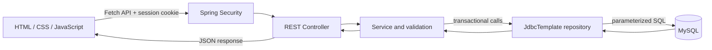
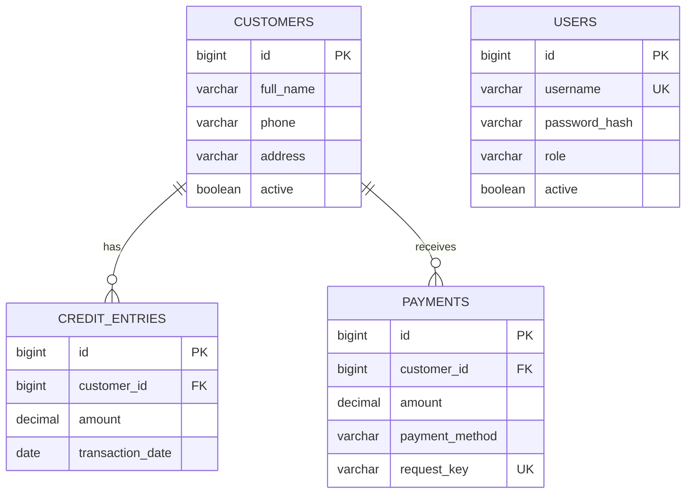
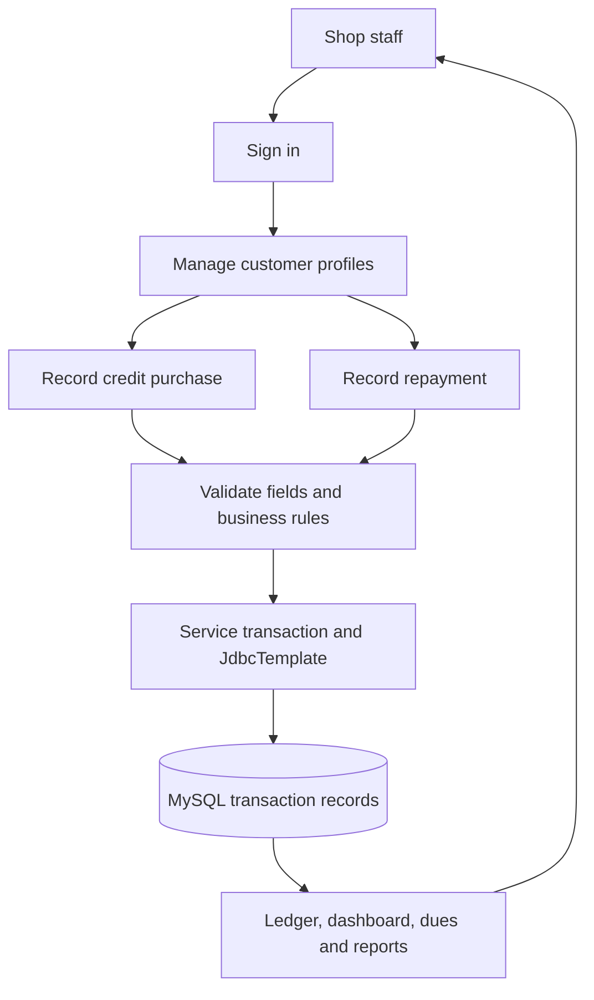

# Smart Shop Credit Tracker

## Title page

**Project title:** Smart Shop Credit Tracker – Customer Credit and Payment Management System  
**Submitted by:** [Student name]  
**Register number:** [Register number]  
**Department:** Information Technology  
**Institution:** [College name]  
**Academic year:** [Academic year]  
**Project guide:** [Guide name]

> Replace bracketed details with the student's real information. Do not submit sample data as real business records.

## Abstract

Small shops may track customer credit purchases and repayments in notebooks. Finding current dues, retrieving an older entry, and preparing collection summaries can be time-consuming. Smart Shop Credit Tracker is a browser-based academic application for storing customer profiles, credit purchases, payments, customer ledgers, pending dues and reports. A plain HTML/CSS/JavaScript frontend communicates with a Spring Boot REST API. The Java backend uses Spring JDBC/JdbcTemplate and parameterized SQL to store transactions in MySQL. Customer balances are computed from the stored credit and payment rows. The application demonstrates validation, hashed staff passwords, session authentication, transaction handling and a responsive interface. Actual deployment results must be recorded only after the application is run and tested in the student's environment.

## 1. Introduction

Shop staff need to know which customers have outstanding credit and what transactions contributed to each balance. A centralized record can make this information easier to search and summarize than scattered manual notes. The application focuses on transparent transaction storage and reproducible balance calculations rather than claiming to eliminate every record-keeping error.

## 2. Problem statement

Paper or disconnected records can make it difficult to identify a customer's current outstanding amount, track partial payments, inspect a chronological history, and prepare daily or date-range reports. Manual calculations can be inconsistent if entries are missed or duplicated.

### Existing system and limitations

- Credit and repayments can be recorded in notebooks or separate records.
- Searches and totals may require manual review.
- Partial payments may be difficult to reconcile with an earlier credit.
- Multiple staff members may not share a single current record.
- Manual entries can be lost, duplicated or calculated incorrectly.

## 3. Proposed system and objectives

The application provides a central customer list and stores every credit and payment as a separate MySQL row. It calculates each outstanding balance as total credits minus total payments, and presents that result in customer details, dashboard, pending dues and ledger views.

Objectives:

1. Register, search, edit and archive customer profiles.
2. Record credit purchases and partial/full repayments.
3. Validate amounts and reject payments above the current outstanding amount.
4. Display a chronological customer ledger with running balance.
5. Generate dashboard statistics, pending dues and date-range reports from persisted rows.
6. Demonstrate a layered Java/JDBC REST architecture and browser API integration.

## 4. Requirements

### Hardware

- A computer capable of running a supported JDK, MySQL Server and a current browser.
- Network connectivity for initial Maven dependency downloads and Bootstrap CDN assets.

### Software

- JDK 17 or newer; Maven can be supplied by the included Maven wrapper.
- MySQL Server 8.0+.
- VS Code, Java/Spring extensions, and a static-file server such as Python's `http.server` or Live Server.
- Browser and (optionally) MySQL Workbench.

## 5. System architecture

Controllers map HTTP requests, services enforce rules, repositories issue parameterized SQL, and MySQL persists the records. The browser does not connect directly to the database.

## 6. Functional modules

1. **Login and staff access:** Staff signs in with a database account; passwords are BCrypt hashes. Browser APIs use a session cookie and CSRF token.
2. **Dashboard:** Displays active customer count, recorded credits, payments, outstanding value, customers with dues and recent transactions.
3. **Customer management:** Create/search/view/edit and archive/restore. Archiving preserves credit and payment rows.
4. **Credit management:** Record customer, description, positive amount, date and optional note.
5. **Payment management:** Record a positive cash/UPI/other payment, reject overpayment, and show the remaining amount.
6. **Customer ledger:** Shows customer details, aggregate totals and chronological credit/payment entries with a running balance. Same-day credits precede payments; IDs order entries within each transaction type.
7. **Pending dues:** Shows customer, phone, estimated oldest credit date, days since that date and outstanding amount. Because payments are not assigned to individual credit rows, age is an estimate, not the precise age of each unpaid rupee.
8. **Reports:** Credit, payment collection and outstanding reports; credit/payment reports can be filtered by date and exported as CSV.

## 7. Database design

| Table | Purpose | Important relationship/constraints |
|---|---|---|
| `users` | Staff username, BCrypt hash, role and active flag | Username unique |
| `customers` | Customer identity/contact and archive status | Primary key `id` |
| `credit_entries` | Individual credit purchases | FK to customers; amount > 0 |
| `payments` | Individual repayments, method and retry key | FK to customers; amount > 0; request key unique |

One customer can have multiple credit entries and multiple payments. A payment is currently not linked to a specific purchase.

`DECIMAL(12,2)` is used for currency and maps to Java `BigDecimal`. A displayed balance is calculated as `SUM(credit_entries.amount) - SUM(payments.amount)`; there is no cached balance field that can drift from the transactions.

## 8. Data flow and use cases

Use case summary: staff signs in; manages customers; records a credit or repayment; views customer ledger; searches pending dues; and filters/exports reports.

## 9. Implementation details

The frontend sends JSON requests using Fetch API. Spring controllers validate DTOs with Bean Validation. The service layer checks customer status, date rules and payment balance. The JDBC repository uses prepared/parameterized SQL. Financial operations run in a transaction and lock the customer's row to serialize concurrent balance checks. Payment requests use a unique request key for duplicate-submit protection. The database remains the source of truth.

## 10. Testing methodology and expected results

Run backend tests from `backend` using `.\mvnw.cmd test`. Unit tests cover rejection of an overpayment, the ₹2,000 credit → ₹800 payment → ₹1,200 remaining example, full settlement to zero, and duplicate request-key handling.

Expected manual checks:

| Test | Expected result |
|---|---|
| Valid customer registration | Customer is saved and searchable. |
| Invalid name/phone | Validation error; no customer saved. |
| ₹2,000 credit followed by ₹800 payment | Current balance equals ₹1,200. |
| Further ₹1,200 payment | Current balance equals ₹0. |
| Zero/negative amount or payment above balance | Request rejected; no payment row inserted. |
| Unknown customer | Not found response; no transaction inserted. |
| Archive customer | Customer status changes; historical financial records remain. |
| Same payment key submitted twice | Existing result returned; no duplicate payment record. |
| Signed-out call to protected API | HTTP 401; UI returns to sign-in. |
| Database unavailable | Backend logs connection failure; no false successful write. |

**Actual results:** The backend clean Maven package completed successfully and the unit-test run reported 5 tests, 0 failures, 0 errors and 0 skipped. MySQL-backed browser workflow, concurrency, database outage and screenshots still require a local run and are not claimed as executed here.

## 11. Screenshot checklist

Capture screenshots from the student's own running application:

1. Login screen.
2. Dashboard populated from the database.
3. Customer directory and customer detail modal.
4. Add/edit customer form.
5. Credit form and saved transaction.
6. Payment page showing current balance and updated balance after payment.
7. Ravi ledger with ₹2,000 credit, ₹800 payment and ₹1,200 balance.
8. Pending-dues page and estimated age label.
9. Date-range report and CSV export.
10. Validation message for an excessive payment.

## 12. Limitations

- Payments are not allocated to individual purchases, so oldest-credit aging is an estimate.
- No SMS, email or WhatsApp provider is integrated.
- No user administration/password reset interface or multi-shop tenancy.
- No operational backup, deployment, detailed audit log or production security review.
- The project is not automatically suitable for production financial use.

## 13. Future enhancements

Add payment allocation to individual credits, audited corrections, staff administration and password reset, per-shop tenancy, optional reminder integration through a real provider, scheduled database backups, deployment automation, and penetration/security testing.

## 14. Conclusion

The project demonstrates a layered Java web application that persists customer credit and payment records through JDBC and derives balances from those records. It provides a practical academic foundation for learning Spring Boot, REST APIs, SQL, frontend integration and financial validation without claiming business deployment or guaranteed error elimination.

## 15. References

- Spring Boot Reference Documentation: <https://docs.spring.io/spring-boot/>
- Spring Security Reference: <https://docs.spring.io/spring-security/reference/>
- Spring Framework JDBC documentation: <https://docs.spring.io/spring-framework/reference/data-access/jdbc.html>
- MySQL 8.0 Reference Manual: <https://dev.mysql.com/doc/refman/8.0/en/>
- Bootstrap 5 Documentation: <https://getbootstrap.com/docs/5.3/>
